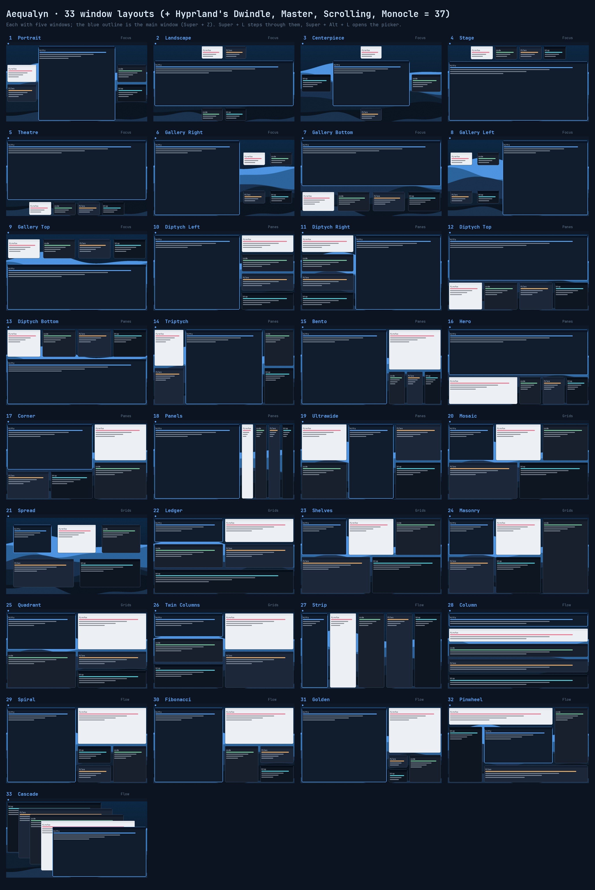

# Aequalyn

Aequalyn is an Arch Linux ISO and desktop built around a [QuickShell](https://quickshell.org/)
shell for [Hyprland](https://hyprland.org/), with wallpaper-driven
[matugen](https://github.com/InioX/matugen) colours applied systemwide.

- **Top bar** — three configurable regions (**left / center / right**). Plugins
  include time, workspaces, media, window title, volume, brightness, CPU,
  network, **Bluetooth**, battery, temperature, system tray, **screen recorder**,
  **caffeine**, and **power menu**. Plugins are toggleable and can be reordered
  or moved between regions from **Settings → Top bar** (drag-and-drop or precise
  move controls). The Arch apps-menu and settings gear are bar items that can
  be placed in any region or hidden.
- **Bar and docks** — the bar is painted behind its widgets as a band, a pill,
  isles or a pebble per widget, in 26 Aequalyn looks; up to 16 docks (4 per
  edge of each screen) wear the bar's look or one of their own, and 8
  ensembles dress both at once. Set in **Atelier → Bar / Docks**
  (`settings.json` → `barStyle`, `~/.config/aequalyn/docks.json`); IPC
  `qs ipc call dock toggle|show|hide|add|settings <n>`.
- **Bluetooth** — bar indicator (power toggle on click, Settings on right-click)
  and **Settings → Bluetooth** for adapter power, scanning, device
  connect/disconnect/forget, and **audio profile** selection (A2DP vs HSP/HFP)
  for connected headsets. Backed by Quickshell's native `Quickshell.Bluetooth`
  (BlueZ over D-Bus) plus `pactl` card profiles.
- **Universal clipboard** — `Super + C / V / X / A` copy, paste, cut and
  select-all in every app (terminals get `Ctrl+Shift+C/V` automatically).
  `Super + Ctrl + V` opens the searchable history overlay (text **and**
  images). Backed by `wl-paste --watch`.
- **Power menu** — QuickShell power menu with Lock, Log out, Reboot, and
  Shutdown (`qs ipc call power toggle`; bar plugin; keybind depends on host
  config, e.g. `Super+Shift+M` or `Super+M`).
- **Screen recorder** — bar plugin and `Super + Shift + R` toggle via
  `bin/aequalyn-record` (`gpu-screen-recorder`), saving to `~/Videos/Aequalyn-*.mp4`.
- **Screenshots** — bar plugin and keybinds via `bin/aequalyn-screenshot`
  (`grim`/`slurp`/`wl-copy`); every shot is saved to
  `~/Pictures/Screenshots/Aequalyn-*.png`, and the default shortcuts copy it to
  the clipboard too.
- **Snapshots** — `snapper` on Btrfs plus
  [`limine-mkinitcpio-hook`](https://aur.archlinux.org/packages/limine-mkinitcpio-hook)
  and
  [`limine-snapper-sync`](https://aur.archlinux.org/packages/limine-snapper-sync)
  from the AUR, so snapshots appear as a **Snapshots** submenu in the Limine
  boot menu. Both packages are pre-built into the ISO's offline repo.
- **Atelier** — one picker for themes, wallpapers, rotation and palette
  (`Super + T` / `Super + W`). Six layouts per collection (grid, carousel,
  filmstrip, radial, list, spotlight) with live preview of themes on the whole
  shell. Wallpapers can be static, cycle through the active theme's
  backgrounds, run as a slideshow, follow the time of day, differ per
  workspace or play as video (`mpvpaper`), with awww transitions on every
  monitor. Colours follow the wallpaper or stay pinned to a theme, with a
  choice of matugen scheme, contrast and dark / light / auto.
- **37 window layouts** — 33 of Aequalyn's own (Portrait, Landscape,
  Centerpiece, Stage, Theatre, four Galleries, four Diptychs, Triptych, Bento,
  Hero, Corner, Panels, Ultrawide, Mosaic, Spread, Ledger, Shelves, Masonry,
  Quadrant, Twin Columns, Strip, Column, Spiral, Fibonacci, Golden, Pinwheel,
  Cascade) plus Hyprland's Dwindle, Master, Scrolling and Monocle. One per
  workspace, kept across reboots; `Super + L` steps through the ones you
  keep in the cycle, `Super + Alt + L` shows them all in Atelier.
- **Folder themes** — a palette plus backgrounds (`colors.toml` +
  `backgrounds/`) install as they are:
  `aequalyn-themes install <git-url>`.
- **Default wallpaper** — `assets/beach.jpg`. Changing it recolours the whole
  system (shell, Hyprland, GTK, Qt, terminals, btop, hyprlock) via matugen, on
  every monitor.
- **Settings page** — Appearance / Top bar / Hyprland / Bluetooth / Displays /
  Power / About, backed by `~/.config/aequalyn/settings.json` (`Super + ,`).
- **Power & idle** — screen lock, display-off and suspend each have their own
  timeout and on/off switch (`Settings -> Power`), generated into hypridle's
  config. `Super + Shift + C` toggles Caffeine (idle inhibit), and its state
  survives shell restarts.
- **Colours** — one wallpaper change repaints the shell, Hyprland borders,
  kitty, foot, fuzzel, GTK 3/4, qt6ct, btop and hyprlock.
- **Defaults** — Hyprland, kitty, fuzzel, chromium, nautilus, grim/slurp/swappy,
  hyprlock/hypridle (lock 5 min, display off 6 min, suspend 15 min — all
  configurable), awww wallpapers, zram, snapper snapshots.
- **Installer** — hybrid offline/online, dual-boot, LUKS2, Btrfs subvolumes,
  Limine, package profiles, config-first `install.toml`, L1 hardware proposal.

The full change log is in [`Aequalyn.md`](Aequalyn.md).

## Repositories

Aequalyn is split across the [Aequalyn](https://github.com/Aequalyn) organisation:

| Repository | What it holds | Installed to |
| --- | --- | --- |
| [aequalyn](https://github.com/Aequalyn/aequalyn) | `aequalyn-*` commands, default config, `install.sh` | `~/.local/bin`, `~/.config` |
| [aequalyn-shell](https://github.com/Aequalyn/aequalyn-shell) | Quickshell desktop: shaped bar, up to 16 docks, launcher, Atelier, settings | `~/.config/quickshell` |
| [aequalyn-themes](https://github.com/Aequalyn/aequalyn-themes) | Folder themes (palette + backgrounds) | `~/.local/share/aequalyn/themes` |
| [aequalyn-installer](https://github.com/Aequalyn/aequalyn-installer) | `aequalyn-install` TUI, `aequalyn-detect`, `install.toml` | live ISO `/opt/aequalyn/installer` |
| [aequalyn-iso](https://github.com/Aequalyn/aequalyn-iso) | archiso profile, `aequalyn-iso-make`, `aequalyn-iso-test` | — |
| [aequalyn-pkgs](https://github.com/Aequalyn/aequalyn-pkgs) | Package lists, install profiles, PKGBUILDs, cached AUR builds | — |

This repository:

```
aequalyn/
├── bin/              -> ~/.local/bin           (aequalyn, aequalyn-wallpaper, aequalyn-themes, ...)
├── config/           -> ~/.config              (hypr, matugen, kitty, ...)
├── assets/           default wallpaper
├── docs/             architecture notes
├── install.sh        install Aequalyn into a home directory / /etc/skel
└── VERSION
```

`install.sh` finds the shell and themes next to this checkout
(`../aequalyn-shell`, `../aequalyn-themes`) or clones them.

## Install onto an existing Arch + Hyprland system

```sh
./install.sh                 # installs into $HOME
qs -n -d                     # start the shell
aequalyn-theme ~/Pictures/Wallpapers/beach.jpg
```

Dependencies: `quickshell`, `matugen`, `awww`, `hyprland`, `jq`, `brightnessctl`,
`playerctl`, `ttf-jetbrains-mono-nerd`, plus the Qt6/GTK runtime. See
`packages/desktop.packages`.

## Build the ISO

See [aequalyn-iso](https://github.com/Aequalyn/aequalyn-iso):

```sh
sudo ./bin/aequalyn-iso-make        # uses sibling checkouts of the other repos
```

The ISO boots into the live Aequalyn desktop (user `live`). Run `sudo aequalyn-install`
(or `Super + I`) to install, `sudo aequalyn-repair` to chroot into an existing
system, or `aequalyn-install --detect` to see the hardware proposal.

Boot it in a VM (requires `qemu-full` + `edk2-ovmf`):

```sh
./bin/aequalyn-iso-test                 # newest aequalyn-*.iso, UEFI + KVM + virtio-gpu
RAM=8192 CPUS=6 ./bin/aequalyn-iso-test
```

## Installer contract

`installer/install.toml.example` documents every option. The agent (L1) proposes
a config, the user sees it as a list of differences and approves or edits it,
and `aequalyn-install --config install.toml` applies it identically every time.
Everything works without AI.

## AI and development tools

**Settings → AI tools** can install, update and remove Claude Code, Codex CLI,
GitHub Copilot CLI and Gemini CLI for the current user. They are installed from
their publishers' npm packages under `~/.local/share/aequalyn/ai-tools`; their
commands are linked into `~/.local/bin`. Node.js and npm are required. Agent
sign-in and configuration stay with each provider.

The same manager is available in a terminal as `aequalyn-ai-tool list`,
`aequalyn-ai-tool install codex`, `aequalyn-ai-tool update codex`, and
`aequalyn-ai-tool remove codex`. Removing a tool leaves its settings and
sign-in data in place. The optional Developer profile includes programming
languages, mise, npm and uv; the Store can add packages to an existing system.

## Keybinds

| Key | Action |
| --- | --- |
| `Super + Return` | Terminal |
| `Super + D` | App launcher |
| `Super + Space` | Applications (as `Super + D`) |
| `Super + ,` / gear in bar | Aequalyn settings |
| `apps-menu` Arch logo in bar | App launcher |
| `Super + T` / `Super + Ctrl + Shift + Space` | Atelier: themes |
| `Super + W` | Atelier: wallpapers |
| `Super + Shift + W` | Atelier: rotation |
| `Super + Ctrl + Space` | Next wallpaper |
| `Super + L` / `Super + Shift + L` | Next / previous window layout |
| `Super + Alt + L` | Atelier: layouts |
| `Super + Ctrl + L`, then `1`–`9` | Dwindle, Scrolling, Master, Portrait, Landscape, Centerpiece, Diptych Left, Diptych Right, Mosaic |
| `Super + Ctrl + L`, `0`, then `1`–`0`, `-`, `=` | Strip, Column, Spiral, Gallery Right, Gallery Bottom, Gallery Left, Gallery Top, Spread, Diptych Top, Diptych Bottom, Triptych, Bento |
| `Super + Z` | Make the focused window the main one |
| `Super + ←/→/↑/↓` | Focus the nearest window that way |
| `Super + Shift + ←/→/↑/↓` | Swap with the nearest window that way |
| `Alt + Tab` / `Alt + Shift + Tab` | Step through the windows; let go of Alt to make that one the main window |
| `Super + Ctrl + ←/→` | Swap the focused window with the previous / next in the layout |
| `Super + -` / `=` | Main pane larger / smaller, held to keep going (`Alt`: finer, `Ctrl`: coarser) |
| `Super + O` | Display manager |
| `Super + C` / `V` / `X` / `A` | Universal copy / paste / cut / select-all |
| `Super + Ctrl + V` | Clipboard history (text + images) |
| `Super + Shift + C` | Caffeine (idle inhibit) |
| `Super + Shift + V` | Toggle floating |
| `Super + Shift + R` | Toggle screen recording |
| `Super + Shift + M` / `Super + M` | Power menu (host config may vary) |
| `Super + I` | Installer (live ISO) |
| `Super + Q` | Close window |

> Keybinds can vary by host/integration; check `config/hypr/hyprland.lua` and your local Hyprland config. Many actions are also available via `qs ipc call ...`.

## Wallpapers and themes from the command line

```sh
aequalyn-wallpaper next                     # Super + Ctrl + Space
aequalyn-wallpaper mode slideshow           # static | theme | slideshow | daytime | workspace | live
aequalyn-settings set .wallpaper.interval 15
aequalyn-wallpaper generate aurora          # paint one from the current palette
aequalyn-themes list
aequalyn-themes set tidal
aequalyn-settings set-str .palette.scheme scheme-expressive
```

```sh
aequalyn-layout list                        # all 37
aequalyn-layout set portrait                # focused workspace
aequalyn-layout set mosaic --workspace 3
aequalyn-layout cycle portrait mosaic spiral dwindle   # what Super + L goes through
aequalyn-layout option pane 0.66
```



Everything Atelier does goes through these commands, so a keybind, a script
or an agent gets the same result as the picker.

## Credits

[nightdevil00](https://github.com/nightdevil00) contributed to the code here.

## License

This project is licensed under the GNU General Public License v3.0 (GPL-3.0).
See [LICENSE](LICENSE) for the full text.
